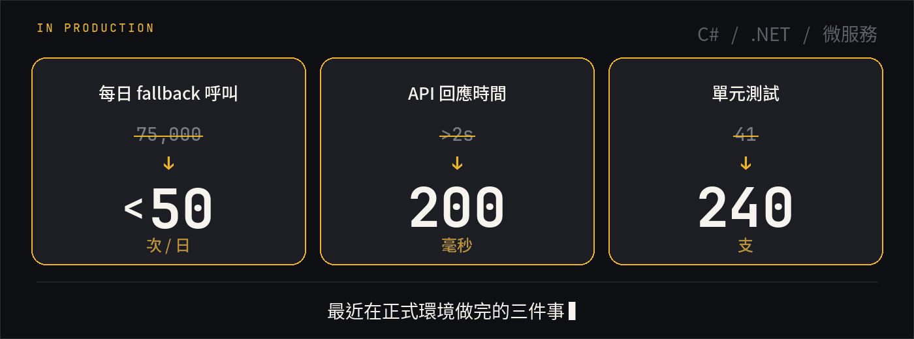

<h1>Tim Chen</h1>

  <strong>後端工程師</strong> · C# / .NET · 微服務

  <a href="https://chenyuting0916.github.io/My-First-Website/">作品集</a>
  &nbsp;·&nbsp;
  <a href="https://www.linkedin.com/in/yuting-chen-63738b135/">LinkedIn</a>
  &nbsp;·&nbsp;
  <a href="mailto:tim376755000@gmail.com">Email</a>

  

SQL Server · ASP.NET Core · gRPC

<table align="center">
  <thead>
    <tr>
      <th align="center">公司</th>
      <th align="center">職位</th>
      <th align="center">期間</th>
    </tr>
  </thead>
  <tbody>
    <tr>
      <td align="center"><strong>Gogoro</strong></td>
      <td align="center">Backend Engineer</td>
      <td align="center">2026.03 — 現在</td>
    </tr>
    <tr>
      <td align="center"><strong>Titansoft</strong></td>
      <td align="center">Product Developer</td>
      <td align="center">2020.08 — 2023.04</td>
    </tr>
    <tr>
      <td align="center"><strong>Titansoft</strong></td>
      <td align="center">Software Engineer Intern</td>
      <td align="center">2020.02 — 2020.07</td>
    </tr>
  </tbody>
</table>

日語 JLPT N1

